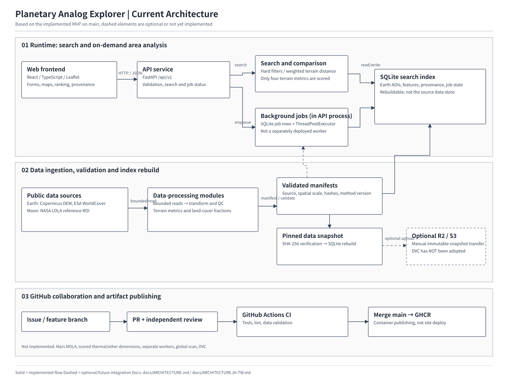

# Architecture

## Architecture diagrams



- [English SVG](diagrams/architecture.en.svg) | [繁體中文 SVG](diagrams/architecture.zh-TW.svg)
- [繁體中文系統架構與完整流程說明](ARCHITECTURE.zh-TW.md)

The diagram describes **implemented MVP behavior**, not the aspirational architecture. In particular, AOI background jobs currently run in a bounded thread pool **inside the API process**; offline provider importers are separate scripts. SQLite is the rebuildable index, while S3-compatible/R2 snapshot transfer is optional and **DVC is not adopted**. The publishing workflow builds GHCR images, not an automatically deployed website. Mars data, scored non-terrain dimensions, separate worker services, and global discovery are future extensions.

## Product boundary

Planetary Analog Explorer ranks **indexed Earth terrain windows** against a user-supplied target
vector. It answers: "among the windows this repository has ingested, which local terrain shapes are
numerically closest to this target?" It does not choose a Moon/Mars base site, claim physical
equivalence, or search all of Earth.

## Components

```
apps/web/ (React + TypeScript + Vite + Leaflet)
        |  /api/v1 (Vite proxy in dev, nginx proxy in Compose)
        v
apps/api/ (FastAPI, Pydantic v2, SQLAlchemy 2, SQLite)
  api/routes.py          versioned HTTP routes (search, dimensions, locations, context, datasets)
  api/routes_aoi.py      on-demand AOI analyze/job/features/compare routes
  domain/features.py     one feature registry (ids, units, scales, method version)
  domain/scoring.py      pure weighted normalized Euclidean ranking
  domain/search.py       orchestration, coverage/exclusions, context export
  domain/aoi.py          AOI validation, cache keys, processor contract
  adapters/db.py         SQLAlchemy models (candidates, context, jobs)
  adapters/repository.py SQLAlchemy -> domain entities
  adapters/earth_aoi.py  Copernicus DEM + ESA WorldCover on-demand provider
  adapters/jobs.py       durable SQLite job rows + bounded local worker pool
  adapters/seed.py       manifest discovery, validation, persistence, data version
  ports/repository.py    Protocol interfaces for storage and references
        ^
        | committed JSON manifests (derived values + provenance)
        |
pipelines/ (offline ingestion)
  src/analog_pipelines/features.py   shared DEM -> 4 terrain metrics
  src/analog_pipelines/storage.py    ObjectStore interface (local/R2-compatible)
  src/analog_pipelines/snapshot.py   pinned snapshots + checksums + publish/fetch
  earth/ingest_copernicus.py         real Copernicus GLO-90 window reads
  worldcover/ingest_worldcover.py    real ESA WorldCover class fractions (context only)
  planetary/lola_import.py           NASA LOLA reference import
  build_index.py                     verified snapshot -> rebuildable SQLite index
samples/                              tiny derived fixtures / documentation
contracts/                            contract, manifest schema, OpenAPI snapshot
```

## Search sequence

1. Frontend loads `GET /capabilities` and renders the supported metrics, units, fixed scales, and
   coverage. The form is generated from the API registry, not a duplicated JS list.
2. User submits `POST /search` with one or more target values, nonnegative weights, a limit in
   1..10, and either `body=custom` or a verified `reference_id`.
3. Pydantic validates shape, known feature ids, finite values, domains, weights, exclusivity, and
   positive total weight (422 on failure).
4. The repository loads indexed candidates. Candidates are excluded with explicit reasons when a
   **positive-weight** requested metric is missing/non-finite or has an incompatible method version.
   Zero-weight metrics are not compared and never affect eligibility.
5. Optional hard filters on Earth land-cover context run before the distance (missing context fails;
   values are never imputed). `rank_candidates` computes
   `sqrt(sum_i[w_i * ((c_i - t_i) / scale_i)^2] / sum_i w_i)`, sorts by `(distance, location_id)`,
   and returns `min(limit, eligible)`.
6. The API adds coverage (`indexed_subset`, indexed count, origins, bbox), a data snapshot ID,
   per-metric and per-dimension distances, source IDs, caveats, and general limitations. With one
   scored dimension the dimension distance equals the overall distance; future dimensions
   aggregate within a dimension before combining weights.
7. The frontend plots returned bboxes/pins, allows list or map selection, fetches
   `GET /locations/{id}` and `GET /locations/{id}/context`, and offers a JSON export for later
   external AI use.

## On-demand AOI sequence

```
POST /areas/analyze (bbox or polygon, requested terrain features)
  -> validate bounds/size/polygon/feature ids; reject URLs (no SSRF surface)
  -> canonical cache key = AOI + features + method/provider versions
  -> cached completed job? return 200 immediately
  -> else create SQLite job row and return 202 (worker pool does not block the request)
  -> worker: Copernicus DEM window read -> reproject 90 m metric grid -> four metrics
             ESA WorldCover window read -> 11 class fractions (context-only)
             validate valid fraction/CRS/nodata -> persist datasets/candidate/observations
  -> GET /jobs/{id}: queued|running|completed|partial|failed with per-provider status
  -> GET /areas/{id}/features: observations + provenance + context
  -> normal POST /search can now rank the new AOI with the same comparator
```

The cache is idempotent per AOI/version. The queue is local and durable: `running` jobs are requeued
after restart, and failed jobs can be retried. No distributed infrastructure is introduced.

## Three data layers

1. **Git**: pipeline code, contracts, configs/catalog, small manifests, snapshot lockfiles,
   docs, tiny fixtures. Never raw rasters or credentials.
2. **Object storage**: optional S3-compatible/R2 store for derived artifacts/snapshots through an
   `ObjectStore` interface. Local filesystem is the default; credentials stay server-side and are
   never exposed to the browser. See `docs/DATA_ARCHITECTURE.md`.
3. **SQLite**: a materialized, rebuildable search index. `build_index.py` verifies a pinned snapshot,
   then rebuilds counts/metadata deterministically. It is not the team's source of truth.

## Data lifecycle

```
official DEM (remote COG / GeoTIFF)
  -> bounded window read (no global download)
  -> reproject to metric CRS / 22x22 grid at 90 m (2 km class), bilinear
  -> valid-data threshold (>= 0.8)
  -> four terrain metrics at method terrain-metrics-1.0.0
  -> ESA WorldCover window -> 11 class fractions (context-only, separate table/array)
  -> validated manifest JSON (dataset provenance + observations + crop checksum)
  -> SQLite index (dataset, candidate, feature/context observations, optional planetary reference)
  -> /api/v1 capabilities/search/locations/context/datasets
  -> UI list, map, detail, export
```

On-demand AOIs enter at the Copernicus/WorldCover window step through the job worker, are persisted
with `origin=on_demand`, and are immediately searchable. Raw rasters and downloads stay out of Git.
The committed artifacts are small JSON manifests with derived values and provenance. Synthetic test
fixtures are programmatically generated and labelled.

## Persistence

SQLite is the zero-credential MVP store. The API talks to the storage layer through
`ports/repository.py`; swapping in PostGIS means implementing the same Protocol and changing the
session factory, not changing scoring or HTTP contracts. Schema creation uses SQLAlchemy
`create_all` for the MVP; a production deployment should introduce Alembic before evolving columns
(see `docs/DATA_MODEL.md`).

## Deployment topology

```
Browser -> nginx (web container, static Vite build, /api proxy)
        -> uvicorn (api container, FastAPI)
        -> SQLite volume /data/analog.db
```

Compose binds web on 8080 and API on 8000. CI runs backend, frontend, and smoke jobs. The publish
workflow builds version-tagged GHCR images after merge to `main`; it does not deploy to a hosting
provider. See `docs/DEPLOYMENT.md`.

## Key decisions

- **Indexed subset, not global search.** The UI says "Top N among M indexed regions" and exposes
  coverage. This is preferable to a false global claim.
- **Terrain shape only.** Comparable local metrics avoid the category error of comparing absolute
  lunar altitude with Earth sea-level altitude.
- **Fixed scales.** Normalization uses registry constants, not the current result range, so adding
  a candidate cannot silently rescale all distances.
- **Manifest handoff.** Pipelines emit validated JSON; the API seed consumes it. Ingestion can be
  re-run independently and CI never needs network data.
- **No AI in the request path.** Context export is deterministic stored facts + computed
  comparisons; a future ChatGPT connector can consume it without inventing evidence.

## Failure modes

| Failure | Behavior |
|---|---|
| Empty index | `409 no_indexed_data`; UI shows no coverage |
| Candidate missing a positive-weight requested metric | excluded with `missing_metric:<id>`; counted in response |
| Positive-weight method-version mismatch | excluded with `incompatible_method_version`; never compared silently |
| Zero-weight metric missing/mismatched | not compared; candidate remains eligible |
| Invalid target/weight/limit | `422` with consistent error shape and field details |
| Source window has <80% valid data | extraction fails; importer records the failure and omits the candidate |
| Remote DEM/tile unavailable | importer documents blocker; no synthetic substitution |
| OSM tiles unavailable | list and details remain usable; UI shows basemap-unavailable message |
| Malformed committed manifest | startup/seed fails loudly with the offending file path |
