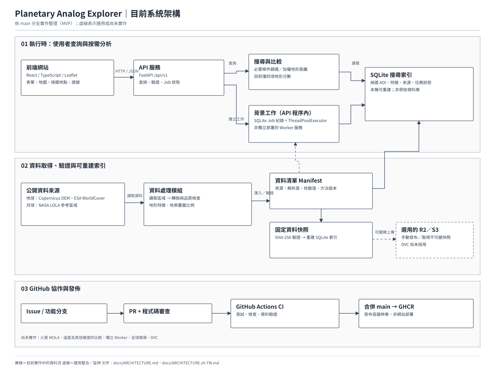

# 系統架構（繁體中文）

> 本文件描述 **2026-11-14 在 `main` 已實作的 MVP 架構**，不是全部未來計畫。若本文與程式碼不同，以實際程式及英文版 [Architecture](ARCHITECTURE.md) 為準，並提交 Issue 修正文件。



[英文架構圖](diagrams/architecture.en.svg) · [英文詳細說明](ARCHITECTURE.md) · [資料架構](DATA_ARCHITECTURE.md) · [資料治理](DATA_GOVERNANCE.md) · [測試方式](TESTING.md)

## 產品範圍

Planetary Analog Explorer 將指定的地形條件，或已驗證的月球參考區域，與**目前已建立索引**的地球小區域（Area of Interest，AOI）進行比較。

目前有五個來自 Copernicus DEM 的地球樣本區域，以及一個由 NASA LOLA 取得的月球參考區域。ESA WorldCover 提供地球地表覆蓋分類的背景資訊。搜尋結果只代表已建立索引的候選地點，不是全球前十名，也不能證明地球環境與月球或火星在物理上等價。

## 元件與責任

| 元件 | 主要位置 | 目前責任 |
| --- | --- | --- |
| 前端網站 | `apps/web/` | React、TypeScript、Leaflet；搜尋表單、地圖、排名、資料來源與限制說明、JSON 匯出 |
| HTTP API | `apps/api/src/analog_api/api/` | FastAPI；輸入驗證、搜尋、資料目錄、AOI 工作建立與狀態查詢 |
| 搜尋與比較 | `apps/api/src/analog_api/domain/search.py`、`scoring.py` | 先進行必要條件篩選，再以固定尺度計算四項地形特徵的加權距離，回傳排除原因與資料涵蓋範圍 |
| 背景 AOI 工作 | `apps/api/src/analog_api/adapters/jobs.py` | SQLite 紀錄工作狀態；API 程序中的 `ThreadPoolExecutor` 執行有限並行工作；支援失敗／部分完成狀態與重啟後重新排程 |
| 即時地球資料分析 | `apps/api/src/analog_api/adapters/earth_aoi.py` | 對指定地球 AOI 讀取 Copernicus DEM 與 ESA WorldCover，計算地形與地表覆蓋特徵 |
| 離線資料處理 | `pipelines/earth/`、`pipelines/worldcover/`、`pipelines/planetary/` | 從公開來源讀取小範圍資料，清理、計算特徵並輸出具有來源與品質紀錄的 Manifest |
| 共同特徵計算 | `pipelines/src/analog_pipelines/features.py` | 將地理高程資料轉成一致分析尺度下的地形特徵 |
| 版本快照與儲存 | `pipelines/src/analog_pipelines/snapshot.py`、`storage.py` | 檢查 SHA-256，建立不可變更的資料快照；支援本機儲存，以及選用的 R2／S3 快照發布與取得 |
| SQLite 索引 | `apps/api/src/analog_api/adapters/`、`pipelines/build_index.py` | 保存候選地點、特徵、來源、工作狀態；可由固定資料快照重建 |

**部署邊界：** 目前背景 Worker 不是獨立微服務，也沒有 Redis、Celery 或分散式佇列。API 和背景工作使用同一個 Python 程序；離線資料匯入腳本可以獨立執行。未來需要擴充時，可以在保留既有介面的前提下再拆成獨立 Worker。

## 使用者流程 A：搜尋已索引的候選地點

1. 前端向 `GET /api/v1/capabilities` 與 `GET /api/v1/dimensions` 取得實際支援的特徵與範圍。
2. 使用者輸入數值條件及權重，或選擇 `GET /api/v1/references` 提供的真實月球參考區域。
3. `POST /api/v1/search` 先排除不符合硬性條件、缺少必要特徵或方法版本不一致的候選區域。
4. 對剩餘候選以加權、正規化的歐氏距離排序；距離越低表示在這四項地形特徵下越接近，**不是相似度百分比**。
5. 回傳候選地點、排名、逐項差異、資料來源、限制與索引涵蓋範圍；前端顯示地圖與詳細資料。

目前只有四項地形特徵參與相似度計算：平均坡度、90 百分位坡度、地形起伏（p95−p05）與去除平面趨勢後的高程標準差。WorldCover 的 11 類地表覆蓋比例目前僅作為背景資訊與部分篩選條件，**不能當作月球礦物或地質材料的跨星球相似度**。

## 使用者流程 B：分析新的地球 AOI

1. 前端以矩形或 Polygon 指定地球上的研究範圍，呼叫 `POST /api/v1/areas/analyze`。
2. API 檢查幾何形狀、大小、特徵與快取鍵；若先前已完成相同版本分析則回傳快取，否則建立 SQLite Job 並回傳 HTTP 202。
3. API 程序內的背景工作讀取指定範圍的 Copernicus DEM 和 WorldCover；完成投影、解析度處理、缺值與品質檢查、特徵萃取。
4. 將有效結果、來源、品質警告與每個 Provider 的狀態寫入 SQLite。部分來源失敗可以回報 `partial`，不會偽造或以 0 取代缺失值。
5. 使用者透過 `GET /api/v1/jobs/{id}` 查詢工作狀態，並透過 `GET /api/v1/areas/{id}/features` 取得結果；新地點之後可參與正常搜尋。

目前對 AOI 的大小和地理位置有限制，且即時分析只支援地球；請以 API 的 `capabilities` 回應為準。這不是「任意選一個月球／火星區域就能立即取得所有資料」的服務。

## 離線資料生命週期與團隊共享

```text
官方來源（NASA / ESA / Copernicus）
  -> 依目標 AOI 讀取小範圍資料
  -> 統一座標與解析度、檢查缺值及品質
  -> 萃取地形特徵或地表覆蓋資訊
  -> 產生有來源、方法版本與 SHA-256 的 JSON Manifest
  -> 驗證後固定到 Snapshot
  -> 重建 SQLite 搜尋索引
  -> 搜尋 API 與前端使用
```

- **Git：** 版本化程式、資料來源目錄、少量 Manifest、固定快照、測試與文件；不提交大型原始 GeoTIFF、快取或 SQLite 資料庫。
- **SQLite：** 可重建的查詢索引，不是團隊唯一的科學資料來源。
- **本機／Cloudflare R2：** 用 `ObjectStore` 介面儲存／同步固定資料快照；R2 是選用的團隊共享方式，正常 API 與離線 CI 不依賴 R2 憑證。
- **DVC：** 目前**未採用**；若未來需要大量二進位資料版本同步，再由獨立 Issue 評估，不能把 DVC 畫成現有執行流程。
- **可信度：** 正式資料的來源、產品版本、取樣區域、分析尺度、品質限制必須能追溯；原始資料不可用時，不得以合成資料假冒觀測。

## GitHub 協作與 CI/CD

`Issue → 功能分支 → Pull Request → Review + CI → 合併 main`。

- `.github/workflows/ci.yml`：後端測試、前端檢查、API 冒煙測試。
- `.github/workflows/data-validation.yml`：在資料相關檔案變更時，離線驗證 Manifest／固定快照與索引重建。
- `.github/workflows/data-smoke.yml`：手動／定期線上來源連線測試；不應阻擋一般 PR。
- `.github/workflows/data-publish.yml`：只允許信任的 `main` 手動觸發；需要適當設定受保護環境與 R2 憑證。
- `.github/workflows/publish.yml`：CI 成功後發布 API／Web 的 GHCR 容器映像；**不等於自動部署到公開網站**。

截至本版撰寫時，Repo 的 `main` Branch Protection 尚未成功啟用；詳細限制和待辦請見 [GITHUB_SETUP.md](GITHUB_SETUP.md)。不要把 GitHub Workflow 檔案存在，誤認為 PR 審查或 Branch Protection 已被技術性強制執行。

## 尚未完成與設計邊界

| 項目 | 狀態 |
| --- | --- |
| 火星 MOLA 參考地點 | 尚未實作 |
| 溫度、礦物、生物、洞穴等跨星球數值相似度 | 尚未實作；需要獨立方法與資料可比較性審查 |
| 全球候選搜尋與全球 Top 10 | 尚未實作；只搜尋已索引地點 |
| 獨立部署的多個 Worker Process／分散式佇列 | 尚未實作 |
| DVC 同步大型資料 | 尚未採用 |
| AI 對話直接影響搜尋排名 | 尚未實作；目前可匯出結構化證據 |

後續新增資料來源時，優先閱讀 [DATA_SOURCES.md](DATA_SOURCES.md)、[FEATURE_REGISTRY.md](FEATURE_REGISTRY.md)、[CONTRIBUTING_DATA.md](CONTRIBUTING_DATA.md)；修改 API 時維護 `contracts/openapi.json`；提交前執行 `bash scripts/verify.sh`。
